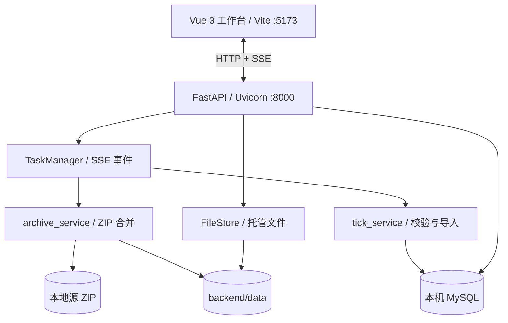

# Tick 数据可视化控制台

基于 Vue 3 + FastAPI 的本地 Tick 数据处理工作台，将 ZIP 扫描、日志合并、质量检查、MySQL 导入和数据查询串成可回放的后台任务流程。

> 默认只连接本机 MySQL。数据库连接信息保存在 `backend/data/database.json`。

## 功能概览

- **本地目录扫描**：直接读取本地 ZIP，不上传或复制大文件。
- **ZIP 日志合并**：支持按月或按年读取压缩包，直接流式读取内部 `log.txt`，只写入有效 `TICK_DATA` 行，不会将 ZIP 解压到磁盘。
- **品种过滤**：按 `underlying_symbol`、合约代码和商品名识别目标品种。
- **数据清洗**：移除 HTML 转义残留，同时输出干净日志和带原因的 `rejected` 文件。
- **质量检查**：校验 JSON、字段、时间、价格和盘口，并可调整重复秒级时间戳。
- **后台任务**：日志合并、质量检查和数据导入均在后端线程执行，前端通过 SSE 接收进度和日志。
- **任务回放**：任务与事件持久化，刷新页面后仍可从事件游标继续连接。
- **安全清理**：只清理项目托管文件、临时目录和任务日志，不删除本地源 ZIP 或 MySQL 数据。

## 工作流

```mermaid
flowchart LR
    A[本地 ZIP 目录] --> B[扫描与登记]
    B --> C[读取 log.txt 并筛选合并]
    C --> D{质量检查}
    D -->|通过| E[选择目标数据表]
    D -->|异常| F[查看 rejected 文件]
    E --> G[后台导入 MySQL]
    G --> H[数据查询]
    C -. 生成 .txt .-> I[项目托管文件]
```

## 系统结构



## 目录结构

```text
tick_data_console/
├─ backend/app/
│  ├─ main.py                 FastAPI 路由、SSE 和清理接口
│  ├─ task_manager.py         后台任务、事件和持久化
│  ├─ storage.py              托管文件和索引管理
│  └─ services/               ZIP 合并、校验和 MySQL 导入
│  ├─ tests/test_pipeline.py  后端处理链测试
│  └─ requirements.txt
├─ frontend/src/              Vue 工作台与 SSE 状态管理
├─ frontend/package.json
├─ start_backend.ps1
├─ start_frontend.ps1
├─ restart_backend.ps1
└─ stop_backend.ps1
```

## 快速启动

```powershell
cd D:\www\py_project\tick_data_console
.\start_backend.ps1
```

后端地址：`http://127.0.0.1:8000`，接口文档：`http://127.0.0.1:8000/docs`。

另开 PowerShell 窗口启动前端：

```powershell
cd D:\www\py_project\tick_data_console
.\start_frontend.ps1
```

前端地址：`http://127.0.0.1:5173`。停止或重启后端分别执行 `./stop_backend.ps1` 和 `./restart_backend.ps1`。

## 使用步骤

1. 在“数据库配置”填写本机 MySQL 参数，测试并保存。
2. 在“ZIP 合并”点击“浏览文件夹”选择 ZIP 所在目录，系统会自动扫描；也可手动填写路径。
3. 选择处理范围和 ZIP 文件，再选择目标品种并启动合并任务。
4. 在“运行日志”查看 SSE 实时进度，在“质量检查”确认异常与 rejected 文件。
5. 在“数据导入”选择日志和目标表，启动导入。
6. 在“数据查询”按表、合约、关键词或时间范围查看数据。

## 数据与安全边界

| 路径 | 用途 | 清理入口 |
| --- | --- | --- |
| `backend/data/uploads` | 旧上传流程预留目录，当前不接收 ZIP 上传 | 删除 |
| `backend/data/artifacts` | 干净日志和 rejected 文件 | 删除 |
| `backend/data/extracted` | 合并任务的临时输出目录（历史目录名） | 删除 |
| `backend/data/tasks` | 任务和 SSE 事件 | 删除 |
| `backend/data/files.json` | 托管文件索引 | 删除 |
| `backend/data/database.json` | 数据库配置 | 保留 |
| 本地 ZIP 目录 / MySQL 表 | 原始源数据 / 已导入数据 | 保留 |

清理操作会拒绝正在运行的任务，不会删除原始 ZIP 或 MySQL 数据。

## 品种过滤与输出

目标品种依次从 `underlying_symbol`、`code` 中的品种部分和 `commodity_name` 识别：

```text
A2305.XDCE / underlying_symbol=A  -> 保留
C2303.XDCE / underlying_symbol=C  -> 过滤
```

任务生成 `merged_log_*.txt`（通过基础校验的目标品种数据）和 `merged_log_*_rejected.txt`（异常行及原因）。

## API 速查

| 接口 | 用途 |
| --- | --- |
| `GET /api/health` | 健康检查 |
| `GET/PUT /api/config/database` | 读取/保存数据库配置 |
| `POST /api/local/archives` | 扫描本地 ZIP |
| `POST /api/tasks/extract` | 创建合并任务 |
| `POST /api/tasks/validate` | 创建质量检查任务 |
| `POST /api/tasks/import` | 创建导入任务 |
| `GET /api/tasks/{task_id}/events` | SSE 任务事件流 |
| `GET /api/database/records` | 查询 Tick 数据 |
| `DELETE /api/history` | 清理托管文件和历史任务 |

## 验证

```powershell
cd D:\www\py_project\tick_data_console\backend
.\.venv\Scripts\python.exe -m unittest discover -s tests -v
cd ..\frontend
pnpm build
```

## 当前限制

- 压缩处理暂时只支持 ZIP。
- 导入目标暂时只支持 MySQL。
- 服务重启时运行中的任务会标记为失败，需要重新启动；历史任务和日志仍可查看。
